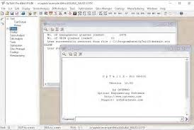
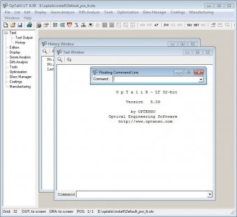

# OpTaliX Pro Optical Designs With Traceable Comparisons

A smaller spot diagram does not explain every change in an optical system.
OpTaliX Pro supports optical design, thin-film engineering, and illumination analysis through a shared modelling environment.
Keep the lens prescription, analysis settings, and design revision together when comparing an optical concept.

## Open a baseline that can be identified later

Begin with an optical system whose units, materials, field points, wavelengths, and aperture definition are known.
Record which configuration is active before interpreting any plot.

The reference manual documents opening a lens file from a Windows command prompt.
For the standard 64-bit Pro executable, this PowerShell example opens a supplied lens file:

```powershell
$optalixExecutable = ".\optalix64p.exe"
& $optalixExecutable ".\lens-review.otx"
```

Use the actual executable location and an existing OTX file.
The network-licence executable has a different name, so match the command to the installed edition.

Keep an unchanged baseline when evaluating another radius, spacing, material, or configuration.
That makes it possible to distinguish a design change from a changed analysis setup.

In the companion collection, [buildScenes.mjs](scripts/buildScenes.mjs) processes scene collections.
[addToGallery.mjs](scripts/addToGallery.mjs) and [addToModules.mjs](scripts/addToModules.mjs) maintain gallery and module entries.

[](https://optalix-pro.github.io/OpTaliX-Pro/)

## Read the prescription before judging its performance

### Surfaces, apertures, and reference geometry

Check the sequence of optical surfaces and the medium following each surface.
Verify the intended stop, clear apertures, and image location.

Tilts and decentres require a consistent reference convention.
A system can look plausible in a layout view while its reference geometry differs from the intended assembly.

The companion [objects.md](ai-tools/knowledge/objects.md) describes objects and JSON representations for a separate two-dimensional simulator.
It provides a concrete example of why an object name needs an associated data definition.

### Configurations and wavelength choices

For zoomed or otherwise variable systems, identify the configuration attached to each result.
Keep the wavelength set and field definition fixed when comparing a controlled design change.

Review the glass or material data used by the prescription.
An index value at one wavelength does not describe dispersion across an entire spectral band.



## Match each plot to the quantity it describes

OpTaliX Pro provides geometric and diffraction analyses.
Select the result that answers the design question, then retain the settings that define that result.

| Result being examined | Context required for interpretation |
|---|---|
| Geometric spot diagram | Field, wavelength, focus, and ray sampling |
| Ray aberration fan | Pupil coordinate, field, wavelength, and aberration component |
| MTF | Spatial-frequency units, field, wavelength weighting, and analysis method |
| PSF | Sampling, wavelength, focus, and normalisation |
| Ghost analysis | Source conditions and the reflection paths being investigated |
| Transmission | Coatings, bulk absorption, wavelength, and polarisation assumptions |

A result from one field point should not be presented as a complete assessment of the image field.
Likewise, a geometric spot estimate and a diffraction-based image calculation describe different models.

Keep comparable axes and normalisation when placing two plots side by side.
Retain the numerical or tabular result when a visual comparison alone hides a small difference.

## Make a short macro report the active system

OpTaliX macros can read lens database quantities and print calculations.
A reporting macro is useful when the same first-order quantities need to accompany each revision.

For a loaded system with a nonzero entrance pupil diameter, save the following as review-first-order.mac:

```text
! First-order quantities for the active review model
print 'Review focal length:' [EFL]
print 'Review pupil diameter:' [EPD]
print 'Focal-length to pupil ratio:' ([EFL]/[EPD])
```

Run it from the OpTaliX command line with the command run review-first-order.mac.
The report reflects the active system and configuration; record those with its output.

The companion integration examples illustrate a different automation boundary:
[example_python.py](integrations/example_python.py) and [example_julia.jl](integrations/example_julia.jl) demonstrate detector readings and image generation.
[runner.js](integrations/runner.js) accepts scene JSON through standard input.

[buildIntegrations.mjs](scripts/buildIntegrations.mjs) assembles that integration distribution.
[webpack.node.config.mjs](webpack.node.config.mjs) configures its Node.js bundle.

These references help separate a data-exchange wrapper from the optical calculation it invokes.
For an OpTaliX macro, use the commands and database items documented for the installed release.

## Evaluate the coating as part of the optical problem

A coating changes transmission and reflection across wavelength, incidence angle, and polarisation.
Record the layer sequence and material data alongside the lens or illumination model.

OpTaliX Pro includes multilayer thin-film analysis and optimisation.
When investigating a simplified planar stack separately, state the simplifications before comparing results.

With NumPy and tmm available, this example evaluates one nonabsorbing film between air and a substrate at normal incidence:

```python
import numpy as np
from tmm import coh_tmm

indices = [1.0, 1.38, 1.52]
thickness_nm = [np.inf, 100.0, np.inf]
result = coh_tmm("s", indices, thickness_nm, 0.0, 550.0)
print(f'Reflectance: {result["R"]:.6f}')
print(f'Transmittance: {result["T"]:.6f}')
```

All thicknesses and the wavelength use nanometres.
The outer media are semi-infinite, and the refractive indices are fixed illustrative values.

This single-wavelength calculation does not include material dispersion or the angle distribution of a complete assembly.
Compare matching physical assumptions before using a separate stack calculation to explain a system-level result.



## Separate nominal improvement from tolerance behaviour

A nominal optimum can depend on a parameter combination that changes during fabrication or assembly.
Define the toleranced quantities and the reported performance criterion before reviewing a tolerance result.

Keep the following distinguishable:

1. The nominal prescription and active configuration.
2. The parameters allowed to vary.
3. The distributions or bounds applied to those variations.
4. The adjustments permitted during compensation.
5. The performance quantity evaluated after each variation.

For non-sequential investigations, document the source and receiver definitions as well.
Those studies may include paths that are absent from a sequential imaging calculation.

The companion [testScenes.mjs](scripts/testScenes.mjs) provides scene-testing infrastructure.
[jest.config.js](jest.config.js) identifies the test collections used by that project.

Keep an analysis comparison repeatable when a design changes.
A test configuration records what was checked; the optical interpretation still depends on the model and reported quantities.

## Assemble a report that preserves its settings

Include the prescription revision, field and wavelength definitions, configuration, aperture, and analysis options.
State what changed between the baseline and the candidate design.

For exchanged prescriptions, inspect geometry and materials after conversion.
Confirm sign conventions, surface types, coordinate references, and wavelength information in the receiving application.

The companion presentation tools cover several distinct tasks:

- [buildImages.mjs](scripts/buildImages.mjs): renders gallery and module images.
- [buildPages.mjs](scripts/buildPages.mjs): constructs website pages.
- [jsdoc.json](jsdoc.json): configures source documentation generation.
- [buildInlineLocaleData.mjs](scripts/buildInlineLocaleData.mjs): prepares inline localisation data.
- [sortTranslations.mjs](scripts/sortTranslations.mjs): orders translated gallery and module entries.

Use consistent terminology across the plot caption, numerical table, and explanatory text.
A translated label should still identify the same physical quantity and units.

## Keep the comparison environment identifiable

Record the OpTaliX edition and release used for the model and macros.
Preserve the original input and any data needed to reproduce material or coating definitions.

For a separate software environment, retain its configuration and dependency information:
[webpack.config.mjs](webpack.config.mjs) defines the browser build;
[package.json](package.json) records package metadata and dependencies;
[package-lock.json](package-lock.json) records resolved dependency information.

The supplied [LICENSE](LICENSE) describes licensing for the companion project.
Keep source credits with reused examples and documentation assets.

An optical report should make the physical assumptions visible without requiring the reader to reconstruct them from build files.
Keep the model, numerical results, and the concise explanation together.

## Related Search Terms

OpTaliX Pro, OpTaliX Pro, optalix software, optalix pro software, optalix pro optical design, optics, geometric-optics, ray-optics, optics-simulation, lens-design, thin-films, optical-design, ray-tracing, python, scientific-computing
